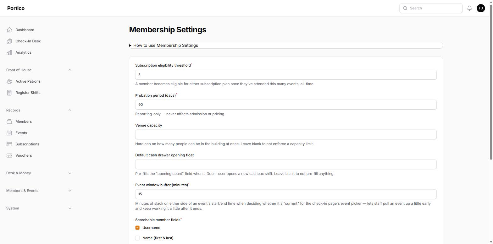
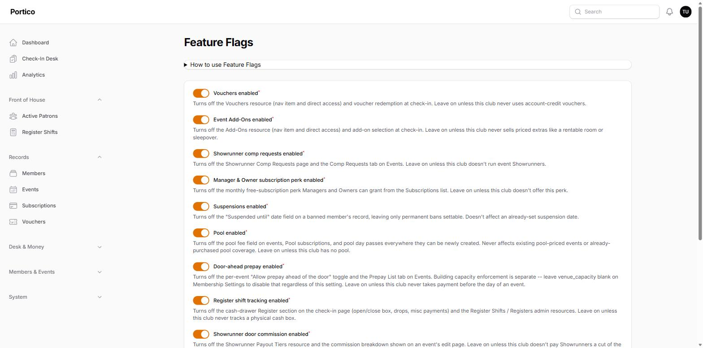

# Configuring Portico for your club

`php artisan migrate:fresh --seed` ships a deliberately small starter set — membership
categories, an `event_types` list, example subscription plans, a few `comp_reasons`,
paperwork types, and payout tiers. **Almost everything below is edited in the admin panel
at runtime** by a Manager, Admin, or Owner — no code change, no redeploy. Set the handful
of `.env` values, then work through the settings screens once.

See also: [`README.md`](../README.md) (install), [`docs/DEPLOYMENT.md`](DEPLOYMENT.md) (LAN
deployment), [`docs/BLUEPRINT.md`](BLUEPRINT.md) (the domain rules), and
[`docs/FEATURES.md`](FEATURES.md) (feature inventory).

---

## Name & branding

- **`APP_NAME`** in `.env` — used in the browser tab, mail, and as the panel brand by
  default.
- **Displayed organization name** on `/admin/membership-settings` (`org_name`, Owner only)
  — overrides the panel brand shown in the sidebar without touching `APP_NAME`. Leave it
  blank to fall back to `APP_NAME`.
- **Organization logo** on the same page (`org_logo_path`, Owner only) — PNG, JPG or WebP up
  to 1 MB, shown instead of the name in the panel header and on the login page, and in place
  of the Portico wheel on the kiosk screen. Pick one that reads on both light and dark
  backgrounds. Stored on the `public` disk under `storage/app/public/branding`, so it needs
  `php artisan storage:link` (the deploy script runs it). Leave empty to show the name.
- The admin footer links to the canonical Portico repository. If you deploy a **modified**
  version, the AGPL requires you to offer that source to your users — point the link at
  your own fork (`resources/views/filament/admin/footer.blade.php`).

## Roles & their labels

Seven fixed, nested roles — `Showrunner ⊂ Volunteer ⊂ DM ⊂ Door ⊂ Manager ⊂ Admin ⊂
Owner` — enforced with plain Laravel policies and gates keyed on `users.role`. There is no
permissions package and the hierarchy is not configurable.

What *is* configurable is the **display name** of each role. `/admin/role-labels`
(Manager+) aliases what staff see without changing the enum cases, the hierarchy, or a
single gate. `Showrunner` and `DM` ship with generic defaults ("Event Lead" and "Monitor")
precisely so a club that dislikes that jargon can rename them.

Create real staff accounts under **Users** (`/admin/users`, Admin+) and stop using the
seeded admin login for day-to-day work.

## Settings screens

All are Manager+ unless noted. They're grouped in the left nav exactly as listed here.

### Desk & Money

| Screen | What it's for |
|---|---|
| **Subscription Plans** | Regular / Pool plan price and per-visit credit, effective-dated — edit the price and a new row takes effect without rewriting history. |
| **Payment Methods** | The tender types offered at check-in. `code` is immutable once created (historical rows store it). `requires_register_shift` marks a method that needs an open cash drawer and counts toward reconciliation. `one_time_only` marks a method usable once per member ever (e.g. a promo). `icon` (picked from a short list) shows beside what someone paid in the desk's Checked in tonight list; blank shows none. |
| **Add-Ons** | Priced extras sold at check-in (room rental, sleepover, …). `subscribable` gives an add-on a monthly plan + day pass (this is how Pool works). `is_overnight` keeps a guest visible on Active Patrons past their event. An add-on can be waiver-gated via Paperwork Types. |
| **Comp Reasons** | The reasons a Manager can waive one visit's entry fee. Ships with Presenter, Volunteer, and Guest of a staff member. A `grants_voucher_amount` auto-issues a reward voucher once that event ends (run `vouchers:grant-comp-rewards`). |
| **Registers** | The physical cash drawers/tills. Only relevant if `register_shifts_enabled`. |
| **Cleaning Tasks** | The checklist items on the Cleaning Checklist page. |

### Members & Events

| Screen | What it's for |
|---|---|
| **Categories** | Membership categories and their flags (`is_comped` = never charged entry). **Prospective, Guest, and Irregular are protected** — business logic matches them by name, so they can't be renamed or deleted (everything else about them is editable). |
| **Paperwork Types** | Waivers/forms a member signs. `required`, `renewal_months`, and `gates_add_on_id` (e.g. a Pool Waiver that gates the Pool add-on). |
| **Skills** | A tag catalog (e.g. "First aid", "DJ"). Assigning a skill to a member is Admin+; editing the catalog is Manager+. |
| **Event Types** | Social, Class, Munch, … Each event picks one. Its **Instructor Pay Rates** tab sets per-head instructor pay (only if `instructor_payouts_enabled`). |
| **Showrunner Payout Tiers** | Headcount bands for the Showrunner's commission (only if `showrunner_payouts_enabled`). Percentage bands stack like tax brackets on the entry fee (e.g. attendees 36–100 at 10%, 101+ at 15%); a voucher band pays a flat amount for a small event (e.g. up to 35). |

### System

| Screen | What it's for |
|---|---|
| **Users** | Staff accounts and their role. Password strength is enforced; you can't lock yourself or the last Owner out. "Require password change at next login" forces a user to set a new password before doing anything else in the panel. |
| **Feature Flags** | Turn optional features on/off — see below. |
| **Membership Settings** | The operational tunables — see below. |
| **Role Labels** | Per-role display-name aliases — see "Roles" above. |
| **Technical** | Environment info and last-run status of the scheduled commands, with buttons to run the backup and comp-reward jobs on demand. |
| **Upstream Updates** | Admin+, only shown if this fork tracks an upstream remote (see below). Shows pending upstream commits, and optionally a button to trigger a deploy. |

## Membership Settings

`/admin/membership-settings` (Manager+). Every value is seeded from a sensible default; you
rarely need to touch most of them.



### Organization

| Setting | Default | Notes |
|---|---|---|
| Displayed organization name | *(blank)* | Panel brand override — see "Name & branding". |
| Organization logo | *(none)* | Owner only. Replaces the name in the panel header, the login page and the kiosk — see "Name & branding". |
| Language | *(blank — server default, English)* | The admin panel's language for everyone on this install. Lists only languages that have a `lang/{code}.json` translation file; with none installed, English is the only choice. Names you enter yourself (categories, comp reasons, plans, …) are never translated. |
| Currency code | `USD` | A 3-letter ISO 4217 code, used everywhere a money figure is shown — the check-in desk's live totals, every Analytics widget, and every money column in the admin panel. |
| Week starts on | *(blank — follows the language; Monday in English)* | First day of the club's week, for the "this week" figures on Analytics and when the Cleaning Checklist resets. Changing it mid-week re-opens this week's checklist tasks. |

### Admission & membership

| Setting | Default | Notes |
|---|---|---|
| Age of majority | `18` | `AdmissionPolicy` blocks a member below this age outright. Jurisdiction-specific. |
| No-alcohol / mark-hand age | `21` | A member below this age (but at or above "Age of majority") is admitted but flagged. Set equal to "Age of majority" to disable the flag. |
| Subscription eligibility threshold | `5` | Attended-events count that unlocks a subscription. |
| Count attended events from the last (months) | *(blank — all-time)* | Only events attended within this many months count toward the threshold. A member flagged "Subscription eligible" by hand stays eligible. |
| Probation period (days) | `90` | Never blocks admission or changes pricing. A member on probation can't register a guest, unless "Allow guests during probation" (Guests) allows it. |
| Require email at sign-up | on | Whether the Check-In Desk requires an email when a Prospective finishes sign-up or a guest is registered. Name is always required. |

### Guests

| Setting | Default | Notes |
|---|---|---|
| Allow guests during probation | off | Lets a member still on probation register a guest at the Check-In Desk. |
| Max guests per member per night | *(blank — no limit)* | How many new guests one member may register in a night, counted from when they checked in (a late event doesn't reset it at midnight). Returning guests who check in under them don't count. |
| Move a guest on when their follow-up is sent | on | When a guest is marked "follow-up sent" on the Members list, moves them out of Guest into the category below. Off, they stay a Guest and only the follow-up is recorded. |
| Category after follow-up | *(blank — Irregular)* | Where a guest goes once their follow-up is sent. If the chosen category is later deleted, Irregular is used. |

### Watchlist

| Setting | Default | Notes |
|---|---|---|
| Watchlist: who staff notify | *(blank — uses `WATCHLIST_NOTIFY_LABEL`)* | Where staff post a heads-up before admitting a watchlisted member; the desk shows "Notify …" and asks staff to confirm. Blank falls back to the `.env` value (default "the staff channel"). |
| Watchlist probation | Same as new-member probation | When an Owner takes a member off the watchlist, they can start a probation, and staff see "Recently off watchlist" at the desk and on Active Patrons. "Same as new-member probation" uses the probation period and guest rule above; **Custom** sets its own length in days and whether it blocks guests (off by default: informational only); **Off** disables it. |

### House Policy

What the Check-In Desk's status bar says, in the club's own words, for four situations: **banned**, **on the watchlist**, **under the age of majority** and **under the no-alcohol age**. Each has a **Headline** (the bar's big line, up to 120 characters) and a **What to do** line under it (up to 255). Every field starts blank, which keeps the shipped wording (shown as the field's placeholder), so upgrading changes nothing. `:age` fills in that situation's age from Admission & membership, and `:label` the watchlist's "who staff notify".

It's wording only. Who gets in, the bar's colour and the watchlist's "I have notified" tick-box don't change. A deceased member and a banned member's one-night exception keep the shipped wording. Everyone at the desk sees this text, so don't put names or ban/watchlist reasons in it; those stay Manager+ as before. **Admin and Owner** can change it; a Manager sees it read-only.

### Events & check-in

| Setting | Default | Notes |
|---|---|---|
| Venue capacity | *(blank)* | Building-wide occupancy cap across concurrent events. **Blank = not enforced.** |
| Event window buffer (minutes) | `15` | Slack around an event's start/end for the check-in picker (also handles an event running past midnight). |
| Check-in closes before the end: overnight / same-day events (minutes) | `60` / `30` | The default check-in close time for a new event, this many minutes before it ends; "overnight" is an event that runs past midnight. Each event can override it. After the close, the desk and kiosk take no new check-ins; marking prepaid arrivals still works. Changing this doesn't move events already saved. |
| Let a first visit check in after close | on | The desk can still check in someone on their first visit (e.g. a new member finishing paperwork) after check-in has closed. Off, check-in closes for everyone. The kiosk is always closed after close. |

### Check-In Desk

| Setting | Default | Notes |
|---|---|---|
| Searchable member fields | `Username` | Which fields the member search boxes match on, and what shows in member dropdown labels. |
| Check-in desk display name | Preferred name | What the desk shows once a member is selected (greeting line, checked-in roster, voucher labels, sponsor note): preferred name, full name or username. Falls back to username when the chosen field is blank. |
| Default cash drawer opening float | *(blank)* | Pre-fills the opening count when a shift is opened. |

### Members list & Active Patrons

| Setting | Default | Notes |
|---|---|---|
| Hide personal info by default on the Members list | on | Whether the Members table masks name/DOB/email until "Show personal info". |
| Show staff roles on Active Patrons | on | Active Patrons notes which staff are signed in ("Also in the building"). Off lists their names without each person's role. |

### Kiosk (collapsed)

| Setting | Default | Notes |
|---|---|---|
| Kiosk "Show on kiosk" time (seconds) | `60` | How long the kiosk tablet shows a member's code sent with "Show on kiosk" (10–300). Only matters while "Show codes on the kiosk" is on. |
| Kiosk "checked in" message time (seconds) | `4` | How long the kiosk shows "checked in" / "already checked in" before it's ready for the next person. |
| Kiosk problem message time (seconds) | `7` | How long the kiosk shows any other result, such as "see staff" or "code not recognized". |
| Kiosk ignores a repeated code for (seconds) | `8` | So a code still held up to the camera isn't scanned twice. A different code scans right away. |
| Kiosk scans allowed per minute | `30` | The kiosk's rate limit; past it, the tablet asks the member to wait. It stops anyone guessing codes. Can't go below 30. |
| Kiosk codes emailed per click | `50` | How many subscribers one click of "Email kiosk codes" (Subscriptions) sends to. Lower it if a slow mail server times the page out. |

### Updates & deploy (collapsed)

| Setting | Default | Notes |
|---|---|---|
| Upstream remote / branch | *(blank)* / `main` | A git remote already added on the server (this app never runs `git remote add` itself) that this fork tracks for updates. |
| Deploy Scheduled Task name | *(blank)* | The exact name of a Windows Scheduled Task, already registered on the server, that "Run update now" fires — see [`docs/DEPLOYMENT.md`](DEPLOYMENT.md) §7 "Web-triggered updates". |

## Feature Flags

`/admin/feature-flags` (Manager+). Every flag defaults **on** except the ones marked *(default off)* below: an
opt-in desk behavior, the kiosk (it needs a tablet set up first), or the upstream-update pair,
which has nothing to do on a fresh install with no upstream remote configured. **A flag stops *new* writes
— it never hides data already collected**, so turning one off after use leaves existing
records intact and reviewable.



Turning a feature **on** sends whoever saved it a notification (the bell) for each setup step it still needs, such as a Pool price or a linked waiver, with an **Open** button to the right screen. Steps already done are skipped.

| Flag | Off means |
|---|---|
| Vouchers | No Vouchers resource and no voucher redemption at check-in. |
| Event Add-Ons | No Add-Ons resource and no add-on selection at check-in. |
| Showrunner comp requests | No Showrunner Comp Requests page or Comp Requests tab on Events. |
| Manager & Owner subscription perk | No monthly free-subscription grant from the Subscriptions list. |
| Suspensions | No "Suspended until" date on a banned member — permanent bans only. |
| Pool | No pool fee on events, Pool subscriptions, or pool day passes for anything newly created (existing pool coverage is untouched). |
| Door-ahead prepay | No per-event "Allow prepay ahead of the door" toggle or Prepay List tab. |
| Register shift tracking | No cash-drawer section at check-in and no Register Shifts / Registers resources. |
| Cash envelope reminder | *(default off)* Closing a box shows only the variance. When on and cash was collected, the confirmation stays up and tells staff to envelope the night's cash with its Entry / Other amounts and the event(s) or date, with subscription cash and each event's prepaid cash in envelopes of their own. Reminder only, nothing saved. |
| Cash for electronic payments | *(default off)* Adds "Cash for an electronic payment" to the desk's Cash box: someone pays by Venmo (or another non-cash method) and gets the same amount in cash. The cash comes off the box's expected count and the money received is listed apart from takings; it isn't revenue. A method's transaction fee is added to what they send. No effect while register shift tracking is off. |
| Subscription cash in its own envelope | The envelope reminder puts subscription cash in the night's envelope, listed as its own amount, instead of a separate envelope labelled with the date. Only changes what the reminder says; no effect while the reminder is off. |
| Hold desk prepay cash for its event | Cash the desk takes for a later event stays in tonight's box and is counted with it. When on, it goes in that event's prepay envelope and the box's expected count leaves it out. Only affects payments taken from then on. Cash recorded on an event's Prepay List is always held for the event. |
| Showrunner door commission | No Showrunner Payout Tiers resource or commission breakdown on events. |
| Instructor per-head pay | No Instructor Pay Rates tab on Event Types or instructor payout breakdown. |
| Patron visit notes | No visit-note column on Active Patrons. |
| Patron behavior notes | No adding new behavior notes on Active Patrons (existing ones stay reviewable by Manager+). |
| Guests | No "Register a guest" on the Check-In Desk. Guests already registered keep their records and can still check in. |
| Day passes for later events | *(default off)* The Check-In Desk sells a day pass (e.g. Pool) only for tonight's events. When on, it also offers any upcoming event; that money goes into tonight's box, not held for the event. |
| Door can rename usernames | *(default off)* Only Manager+ can rename a username, from the member's page. When on, Door gets a "Rename username" button on the Check-In Desk, and each Door rename notifies every active Manager+. |
| Pick the event again for each member | *(default on)* On the Check-In Desk, picking a different member puts Event back to tonight's event, or blank when several events overlap, unless the member is already on exactly one of tonight's events (then that one). Stops one person's event carrying over to the next. Off, Event stays on the last pick. |
| Door can change preferred names | *(default off)* Only Manager+ can change a preferred name (member page, or the desk button). When on, Door gets a "Change preferred name" button on the Check-In Desk too. Not logged. |
| Kiosk check-in | *(default off)* No kiosk: no "Kiosk QR code" button at the desk or on the member page, and the kiosk page answers "not found". When on, a member scans their code at a tablet and is let in only when they owe nothing; anyone else is sent to the desk. With it on, Admin+ gets a **Set up a kiosk tablet** button on this page, which makes the link to open on the tablet; making a new one stops a tablet already set up until it opens the new link. Setting up the tablet: [`docs/DEPLOYMENT.md`](DEPLOYMENT.md) "A kiosk tablet". |
| Check in staff when they sign in | *(default off)* Signing in does nothing extra. When on, a login linked to a member (My account or Users) checks that member in to tonight's event when they owe nothing: a subscription, a comped category, the host or a free event. Money due, two events at once, check-in closed or full, or a watchlist or ID check tells them to go to the desk (a notice and the bell) and notifies the Door staff signed in. Signing in when no event is running does nothing. |
| Report a problem from the desk | *(default off)* No button. When on, the Check-In Desk has **Report a problem**: staff describe what went wrong and it saves what the desk is showing, without names, contact details, date of birth, notes or reasons, under Records > Issue reports (Manager+). Reports already saved stay readable with it off. |
| Kiosk admits subscribers only | The kiosk also lets in anyone else who owes nothing tonight, such as a comped category or the event's host. When on, only a member with an active subscription for the event's month. Anyone with something to pay, a watchlist or ID check is always sent to the desk. Needs Kiosk check-in. |
| Show codes on the kiosk | *(default off)* No "Show on kiosk" button. When on, staff can put a member's code on the tablet for them to photograph (time set on Membership Settings); anyone at the tablet can see it while it's up. Needs Kiosk check-in. |
| Upstream update checking | *(default off)* No Upstream Updates page and no scheduled git fetch. Only useful if this fork tracks an upstream remote. |
| Web-triggered deploy | *(default off)* No "Run update now" button on Upstream Updates. Also needs a Deploy Scheduled Task name configured and a Scheduled Task registered on the server — see [`docs/DEPLOYMENT.md`](DEPLOYMENT.md) §7 "Web-triggered updates". |

## `.env` you'll actually set

Most of `.env.example` is stock Laravel. The values that matter for a real install:

```
APP_NAME="Your Club"
APP_ENV=production
APP_DEBUG=false
APP_URL=http://checkin.yourclub.lan
APP_TIMEZONE=America/Chicago          # your local zone

DB_DATABASE=portico
DB_USERNAME=portico
DB_PASSWORD=...

# Required outside local/testing — the seeder refuses to ship a guessable admin.
ADMIN_EMAIL=you@yourclub
ADMIN_PASSWORD=a-real-password

WATCHLIST_NOTIFY_LABEL="your #members channel"   # default for the watchlist warning; Membership Settings can override it
SYSTEM_USER_EMAIL=system@yourclub.internal       # attributes automated grants

BACKUP_DESTINATION="D:/backups/portico"          # a folder that syncs off the machine
BACKUP_PREFIX=yourclub
# MYSQLDUMP_PATH="C:/Program Files/MariaDB 12.3/bin/mysqldump.exe"

MAIL_MAILER=log     # deferred — post-event notifications only deliver once you wire a real transport
```

## Scheduled commands

Portico has **no Laravel scheduler**. Register each recurring job on a timer (Windows Task
Scheduler or cron) — see [`docs/DEPLOYMENT.md`](DEPLOYMENT.md) §3:

| Command | Cadence |
|---|---|
| `php artisan backup:database` | nightly |
| `php artisan events:notify-ended` | hourly |
| `php artisan vouchers:grant-comp-rewards` | hourly |

## Your first week

1. Set real **Subscription Plan** prices and review **Categories** / **Event Types**.
2. Create real **Users** for your staff; stop using the seeded admin for daily work.
3. Review **Feature Flags** — turn off anything your club doesn't do.
4. Want to explore with realistic data first? Run `php artisan db:seed --class=DemoDataSeeder`
   **on a scratch database only** — never the one you'll go live on.
